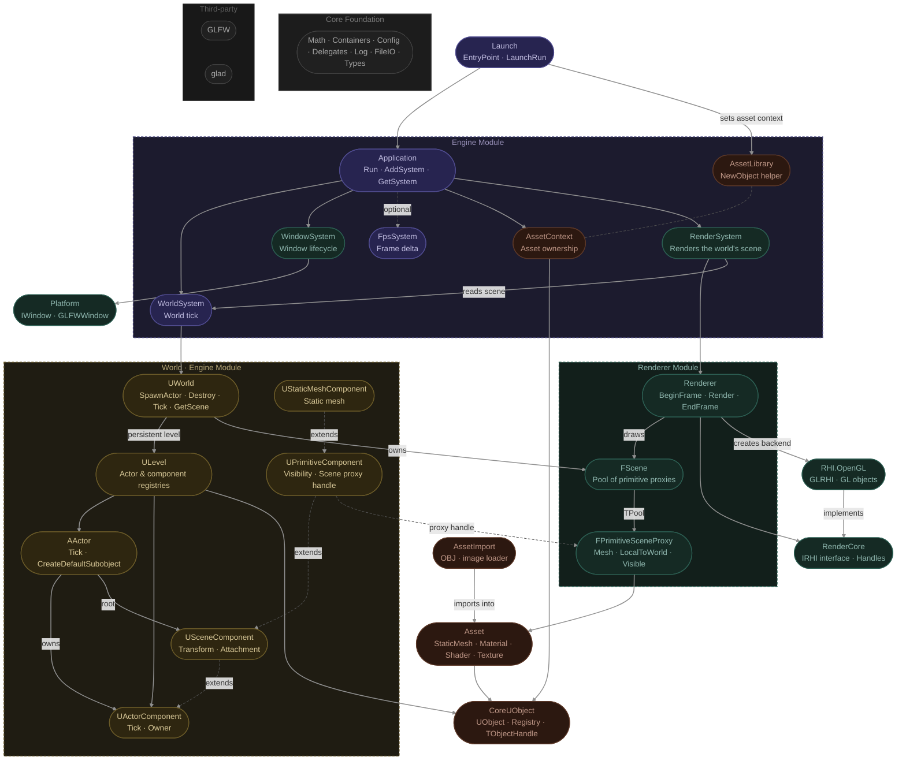

# ClubEngine

ClubEngine is a small C++ game/engine framework. The engine source lives in this repository, while game projects can live anywhere on disk. Projects connect to the engine through the `CLUBENGINE_ROOT` environment variable, a `.clubproject` file, and the ClubEngine tool scripts.

The engine requires **C++20** and **CMake 3.20** or newer. Third-party libraries (GLFW, glad, GLM, stb, nlohmann/json) are bundled, so you don't need to download anything separately.

## Architecture



## Engine Overview

### Conventions

- All engine code lives in `namespace CE`. Low-level rendering types live in `CE::RHI`.
- Type prefixes:

  | Prefix | Used for | Examples |
  |---|---|---|
  | `U` | UObjects | `UWorld`, `UStaticMesh`, `UMaterial` |
  | `A` | Actors (UObjects that live in a level) | `AActor`, `AVoxelTerrain` |
  | `F` | Plain structs and value types | `FTransform`, `FScene`, `FSubMesh` |
  | `E` | Enums | `ELogType`, `ERenderBackend` |
  | `T` | Templates | `TArray`, `TPool`, `TObjectHandle`, `TMulticastDelegate` |
  | `I` | Interfaces | `ISystem`, `IWindow`, `IRHI` |

  Engine services, systems, and backend classes (`Application`, `Renderer`, `RenderSystem`, `GLRHI`, …) and the `CE::RHI` descriptor types don't take a prefix.
- **Coordinate system:** X forward, Y right, Z up, left-handed. Rotators are pitch around Y, yaw around Z, and roll around X. The OBJ importer converts Y-up meshes to engine axes by default (`FObjImportSettings::convertAxes`).
- Classes with more than a few template or inline functions are split into a `.h` declaration and a `.inl` implementation that's included at the bottom of the header.

### Core

`Core` is the foundation module, and everything else depends on it. Include `<Core/ClubCore.h>` to get logging, file IO, math, core types, and containers in one go.

- **Math:** `FVector`, `FQuat`, `FTransform`, `FMatrix4x4` (templated on float/double, with `F` aliases like `FVectorF` and `FMatrix4x4F`), plus `Lerp`, `Slerp`, `Nlerp`, `LookAt`, and the inverse-transform helpers.
- **Containers:**
  - `TArray<T>` is currently an alias of `std::vector<T>`.
  - `TPool<T>` is a dense pool that hands out generational `TPoolHandle<T>`s. Items stay packed for fast iteration, and removing one swaps the last item into its place, so iteration order isn't stable. Always go through the handle; never keep a `T*` across an `Add` or `Remove`. A handle whose item was removed resolves to `nullptr` instead of pointing at whatever reused the slot.
- **Delegates:** `TMulticastDelegate<Args...>` with `FDelegateHandle`. You can bind free functions, lambdas, or member functions, and it's safe to add or remove bindings while it's broadcasting.
- **Log:** `CE_LOG(Info | Warning | Error, "format {}", args...)`.
- **Config:** INI file loading through `IniParser` and `ConfigSystem`.

### UObjects

- Every engine object (`UWorld`, `ULevel`, actors, components, assets) derives from `UObject` and declares `GENERATED_BODY(Class, Super)`.
- UObjects are owned by a `UObjectRegistry` and **cannot be copied or moved**. Everything else refers to them through `TObjectHandle<T>`, a generational handle, so a handle to a destroyed object simply resolves to `nullptr`.
- A handle converts to a handle of any base class (`TObjectHandle<AActor>` → `TObjectHandle<UObject>`).
- You can destroy objects inside a registry `ForEach`. The object is marked dead immediately, but its memory is freed only after the outermost iteration finishes.

### Application and Systems

- A game derives from `CE::Application`, implements `Update(float dt)`, and optionally overrides `PreInit()` and `PostInit()`. `CreateApplication()` is defined by the game and called from `EntryPoint.h`.
- Engine functionality is split into `ISystem`s, which you add with `AddSystem<T>(args...)` and look up with `GetSystem<T>()`. By default the application adds `WindowSystem`, `WorldSystem`, and `RenderSystem` in that order.
- Systems initialize in the order they were added and shut down in reverse. If one fails to initialize, the ones already initialized are shut down cleanly. If any system's `Update` returns a non-zero code, the application stops.

### World, Levels, Actors, Components

- `WorldSystem` owns a single `UWorld` and ticks it every frame.
- `UWorld` owns a persistent `ULevel` and the world's `FScene`. Spawn actors with `world.SpawnActor<T>(transform, args...)` and remove them with `world.Destroy(handle)`.
- `ULevel` holds two registries, one for actors and one for components. Each level knows its world (`GetWorld()`).
- `AActor` creates its components in its constructor through `CreateDefaultSubobject<T>()`. If an actor doesn't set a root component, it gets a default `USceneComponent` when spawned. Override `Tick(dt)` and `OnSpawned()` for behaviour.
- Component hierarchy: `UActorComponent` → `USceneComponent` (transform, attachment) → `UPrimitiveComponent` (visibility, scene proxy handle) → `UStaticMeshComponent`.

### Rendering

- The renderer never touches UObjects or actors directly. It draws an **`FScene`**, which is a `TPool` of **`FPrimitiveSceneProxy`** entries. Each proxy is plain render data: a static mesh handle, a `localToWorld` matrix, and a visibility flag.
- `FScene` API: `AddProxy`, `RemoveProxy`, `UpdateTransform`, `UpdateStaticMesh`, `SetVisible`, and `ForEachPrimitive`. Each `UWorld` owns its scene, and you can get it with `GetScene()`.
- Every frame, `RenderSystem` calls `Renderer::BeginFrame`, `Render(world.GetScene())`, and `EndFrame`, then swaps the window buffers.
- If a sub-mesh has a missing or invalid material, or its shader failed to compile, the renderer skips it instead of crashing.
- The rendering backend sits behind the `IRHI` interface (`RenderCore`). OpenGL (`RHI.OpenGL`) is the only backend right now.

### Assets

- `UStaticMesh` is a list of `FSubMesh`es (a vertex array, a draw descriptor, and a material index) plus the `UMaterial` handles they use.
- `UMaterial` binds a `UShader` with its uniform values, textures, and render state (blend, cull, depth). `UTexture` loads 1, 2, 3 and 4 channel images and sizes the texture from the image itself.
- Create assets with `NewObject<T>(args...)`. It creates them in the application's `AssetContext`, which owns them.
- `AssetImport` contains the OBJ mesh importer and the stb-based image loader.

### Current Limitations

- Components don't add themselves to the scene yet. `UPrimitiveComponent` and `UStaticMeshComponent` are incomplete, so to show a mesh today, add an `FPrimitiveSceneProxy` to `world.GetScene()` yourself (see the debug mesh in `Application::PostInit`).
- There's no camera, input, pawn/controller, or game mode framework yet. The view is a hardcoded `LookAt`.
- `AVoxelTerrain` / `UVoxelGrid` are work in progress.
- Asset paths and serialization aren't implemented yet; assets are loaded from paths in code.

## Getting Started

---

## Table of Contents

- [Engine Overview](#engine-overview)
- [Windows Setup](#windows-setup)
  - [1. Install dependencies](#1-install-dependencies-windows)
  - [2. First-time tool setup](#2-first-time-tool-setup-windows)
  - [3. Build the engine](#3-build-the-engine-windows)
  - [4. Create a project](#4-create-a-project-windows)
  - [5. Build and run your project](#5-build-and-run-your-project-windows)
  - [6. Register an existing project](#6-register-an-existing-project-windows)
  - [7. Reset the environment](#7-reset-the-environment-windows)
- [Linux Setup](#linux-setup)
  - [1. Install dependencies](#1-install-dependencies-linux)
  - [2. First-time tool setup](#2-first-time-tool-setup-linux)
  - [3. Build the engine](#3-build-the-engine-linux)
  - [4. Create a project](#4-create-a-project-linux)
  - [5. Build and run your project](#5-build-and-run-your-project-linux)
  - [6. Register an existing project](#6-register-an-existing-project-linux)
  - [7. Reset the environment](#7-reset-the-environment-linux)
- [Engine Association](#engine-association)
- [Folder Layout](#folder-layout)

---

---

# Windows Setup

---

## 1. Install dependencies (Windows)

ClubEngine on Windows uses **MSYS2 UCRT64 / MinGW** for its compiler and build tools.

**Step 1 — Install MSYS2**

> **Note:** MSVC and Visual Studio are not supported. The build system requires
> MinGW via MSYS2 specifically — even if you already have Visual Studio installed,
> you still need to complete this step.

Download and install MSYS2 from [https://www.msys2.org](https://www.msys2.org).

**Step 2 — Open the MSYS2 UCRT64 terminal** (not the default MSYS2 terminal — specifically the UCRT64 one) and run:

```bash
pacman -S mingw-w64-ucrt-x86_64-gcc
pacman -S mingw-w64-ucrt-x86_64-cmake
pacman -S mingw-w64-ucrt-x86_64-make
```

**Step 3 — Add MinGW to your Windows PATH**

Add the following folder to your Windows system `PATH` environment variable:

```
C:\msys64\ucrt64\bin
```

To do this: Search for **"Edit the system environment variables"** in the Start menu → Environment Variables → select `Path` under System variables → New → paste the path above.

**Step 4 — Verify from PowerShell**

Close and reopen PowerShell, then check:

```powershell
gcc --version
cmake --version
mingw32-make --version
```

All three should print version numbers. If any command is not found, double-check the PATH entry and reopen PowerShell.

---

## 2. First-time tool setup (Windows)

This registers `CLUBENGINE_ROOT` and adds the ClubEngine tools to your PATH so you can run `club-*` commands from anywhere.

Open PowerShell, navigate to the ClubEngine root folder, and run:

```powershell
.\Tools\Windows\club-init.bat
```

Then **close and reopen PowerShell** for the changes to take effect.

Verify the setup:

```powershell
echo $env:CLUBENGINE_ROOT
where.exe club-build-engine
where.exe club-new-project
where.exe club-build-project
```

All four should return valid paths. If any are missing, re-run `club-init.bat` and reopen the terminal.

---

## 3. Build the engine (Windows)

Run this from anywhere after completing the tool setup:

```powershell
club-build-engine Debug
```

Replace `Debug` with `Release` for an optimized build.

After a successful build, the following folders will be created inside the ClubEngine root:

```
Build\Win64\Debug\0.1.0\
Binaries\Win64\Debug\0.1.0\
Intermediate\Win64\Debug\0.1.0\
```

The version number (`0.1.0`) comes from the `VERSION` field in the root `CMakeLists.txt`. Both `Debug` and `Release` builds can coexist — they output to separate folders.

---

## 4. Create a project (Windows)

Build the engine first. Then run this from anywhere:

```powershell
club-new-project MyGame 0.1
```

The first argument is the project name (also used as the folder name). The second is the engine line to associate with — see [Engine Association](#engine-association) below.

You can also pass a full path:

```powershell
club-new-project C:\Users\YourName\Projects\MyGame 0.1
```

This creates the following structure:

```
MyGame\
  MyGame.clubproject
  CMakeLists.txt
  Config\
    DefaultEngine.ini
    DefaultInput.ini
    DefaultGame.ini
    DefaultRender.ini
  Content\
  Source\
    Entry.cpp
    MyGame\
      Public\
        MyGame.h
      Private\
        MyGame.cpp
```

The project is automatically registered after creation.

---

## 5. Build and run your project (Windows)

Navigate to the project root, then build:

```powershell
cd C:\Users\YourName\Projects\MyGame
club-build-project Debug
```

The build script automatically reads the `.clubproject` file, finds a compatible built engine, and compiles the project.

After a successful build the executable is at:

```
MyGame\Binaries\Win64\Debug\0.1.0\MyGame.exe
```

Run it directly from the terminal:

```powershell
.\Binaries\Win64\Debug\0.1.0\MyGame.exe
```

---

## 6. Register an existing project (Windows)

New projects are registered automatically when created. If you move a project folder or want to register a project that was created manually, run this from the project root:

```powershell
club-register-project
```

Registered projects are stored in:

```
<ClubEngine root>\Saved\ProjectRegistry.json
```

Projects are identified by their full path, so two projects with the same name in different directories can both be registered.

---

## 7. Reset the environment (Windows)

To remove `CLUBENGINE_ROOT` and the ClubEngine tools from your PATH:

```powershell
club-clean-env
```

Or run it directly:

```powershell
.\Tools\Windows\club-clean-env.bat
```

Reopen PowerShell after running.

---

---

# Linux Setup

> **Note:** Linux support is functional but has received limited testing. You may encounter rough edges. Please report any issues.

---

## 1. Install dependencies (Linux)

On Ubuntu or Debian:

```bash
sudo apt update
sudo apt install build-essential cmake ninja-build
```

Because GLFW is bundled and compiled from source, it also needs its system development headers. Install them with:

```bash
sudo apt install libx11-dev libxrandr-dev libxinerama-dev libxcursor-dev libxi-dev libgl1-mesa-dev
```

Without these headers, the GLFW build will fail even though no separate download is required.

Verify the build tools:

```bash
g++ --version
cmake --version
ninja --version
```

All three should print version numbers.

---

## 2. First-time tool setup (Linux)

This registers `CLUBENGINE_ROOT` and adds the ClubEngine tools to your PATH.

From the ClubEngine root:

```bash
chmod +x Tools/Unix/*.sh
./Tools/Unix/club-init.sh
source ~/.bashrc
```

If you use zsh:

```bash
source ~/.zshrc
```

Verify the setup:

```bash
echo $CLUBENGINE_ROOT
which club-build-engine.sh
which club-new-project.sh
which club-build-project.sh
```

All four should return valid values. If any are missing, re-run `club-init.sh` and re-source your shell config.

---

## 3. Build the engine (Linux)

Run this from anywhere after completing the tool setup:

```bash
club-build-engine.sh Debug
```

Replace `Debug` with `Release` for an optimized build.

After a successful build, the following folders will be created inside the ClubEngine root:

```
Build/Linux64/Debug/0.1.0/
Binaries/Linux64/Debug/0.1.0/
Intermediate/Linux64/Debug/0.1.0/
```

If Ninja is installed it will be used automatically; otherwise CMake falls back to the default Make generator.

---

## 4. Create a project (Linux)

Build the engine first. Then run this from anywhere:

```bash
club-new-project.sh MyGame 0.1
```

The first argument is the project name (also used as the folder name). The second is the engine line to associate with — see [Engine Association](#engine-association) below.

You can also pass a full path:

```bash
club-new-project.sh ~/projects/MyGame 0.1
```

This creates the following structure:

```
MyGame/
  MyGame.clubproject
  CMakeLists.txt
  Config/
    DefaultEngine.ini
    DefaultInput.ini
    DefaultGame.ini
    DefaultRender.ini
  Content/
  Source/
    Entry.cpp
    MyGame/
      Public/
        MyGame.h
      Private/
        MyGame.cpp
```

The project is automatically registered after creation.

---

## 5. Build and run your project (Linux)

Navigate to the project root, then build:

```bash
cd ~/projects/MyGame
club-build-project.sh Debug
```

The build script automatically reads the `.clubproject` file, finds a compatible built engine, and compiles the project.

After a successful build the executable is at:

```
MyGame/Binaries/Linux64/Debug/0.1.0/MyGame
```

Run it:

```bash
./Binaries/Linux64/Debug/0.1.0/MyGame
```

---

## 6. Register an existing project (Linux)

New projects are registered automatically when created. If you move a project folder or want to register a project that was created manually, run this from the project root:

```bash
club-register-project.sh
```

Registered projects are stored in:

```
<ClubEngine root>/Saved/ProjectRegistry.json
```

Projects are identified by their full path, so two projects with the same name in different directories can both be registered.

---

## 7. Reset the environment (Linux)

To remove `CLUBENGINE_ROOT` and the ClubEngine tools from your PATH:

```bash
club-clean-env.sh
```

Then re-source your shell config or open a new terminal.

---

---

# Engine Association

Each project has a `.clubproject` file that specifies which engine version it requires:

```json
{
    "FileVersion": 1,
    "EngineAssociation": "0.1"
}
```

`EngineAssociation` is a version *line*, not an exact version. `0.1` matches any built engine with a `0.1.x` patch version:

| EngineAssociation | Matches | Does not match |
|---|---|---|
| `0.1` | `0.1.0`, `0.1.1`, `0.1.2` | `0.2.0`, `1.0.0` |
| `0.2` | `0.2.0`, `0.2.3` | `0.1.0`, `1.0.0` |

When building a project, the build script scans the `Binaries/` folder for the newest built engine that matches the association. If no match is found, the build fails with a clear error message.

---

# Folder Layout

```
ClubEngine/
  CMakeLists.txt          — Root build file (defines engine version)
  Engine/
    Source/Runtime/       — Engine source modules
    ThirdParty/           — Bundled libraries (GLFW, glad, GLM, stb, nlohmann/json)
    Config/               — Base engine config files
    Programs/             — Standalone tools (e.g. AssetImporter)
  Templates/
    Project/              — Template used by club-new-project
  Tools/
    Windows/              — .bat scripts for Windows
    Unix/                 — .sh scripts for Linux
  Saved/
    ProjectRegistry.json  — List of registered projects (auto-generated)
  Build/                  — CMake build trees (generated)
  Binaries/               — Compiled engine output (generated)
  Intermediate/           — Intermediate build artifacts (generated)
```

`Build/`, `Binaries/`, and `Intermediate/` are all generated — they are not in source control and can be deleted to do a clean rebuild.

Game project assets should always live in the project's own `Content/` folder, never inside the engine source tree.
