# ClubEngine

ClubEngine is a small C++ game/engine framework. The engine source lives in this repository, while game projects can live anywhere on disk. Projects connect to the engine through the `CLUBENGINE_ROOT` environment variable, a `.clubproject` file, and the ClubEngine tool scripts.

The engine requires **C++20** and **CMake 3.20** or newer. Third-party libraries (GLFW, glad, GLM, stb, cgltf, nlohmann/json) are bundled, so you don't need to download anything separately.

## Table of Contents

- [Architecture](#architecture)
- [Engine Overview](#engine-overview)
  - [Conventions](#conventions) · [Core](#core) · [UObjects](#uobjects) · [Application and Systems](#application-and-systems) · [World, Levels, Actors, Components](#world-levels-actors-components) · [Rendering](#rendering) · [Assets](#assets) · [Input](#input) · [Current Limitations](#current-limitations)
- [Offline Rendering](#offline-rendering)
- [Getting Started](#getting-started)
  - [Windows Setup](#windows-setup)
  - [Linux Setup](#linux-setup)
- [Engine Association](#engine-association)
- [Folder Layout](#folder-layout)

## Architecture

```mermaid
graph TD
    Launch(["Launch<br/>EntryPoint · LaunchRun"])

    subgraph EngineModule["  Engine Module  "]
        Application(["Application<br/>Run · AddSystem · GetSystem · Asset defaults · Offline render"])
        WorldSystem(["WorldSystem<br/>World tick"])
        WindowSystem(["WindowSystem<br/>Window lifecycle"])
        InputSystem(["InputSystem<br/>Window events → FInputState"])
        FpsSystem(["FpsSystem<br/>Frame delta"])
        RenderSystem(["RenderSystem<br/>Builds view families · owns scene render target · presents"])
    end

    subgraph WorldLayer["  World · Engine Module  "]
        UWorld(["UWorld<br/>SpawnActor by class · SpawnActorDeferred · Destroy · GetScene · View targets"])
        ULevel(["ULevel<br/>Actor & component registries · IsAlive"])
        AActor(["AActor<br/>Tick · FinishSpawning · CreateDefaultSubobject"])
        AStaticMeshActor(["AStaticMeshActor<br/>Static mesh component as root"])
        UActorComponent(["UActorComponent<br/>Tick · Owner · Register / Unregister"])
        USceneComponent(["USceneComponent<br/>World transform · Attachment"])
        UPrimitiveComponent(["UPrimitiveComponent<br/>Visibility · Scene proxy while registered"])
        UStaticMeshComponent(["UStaticMeshComponent<br/>Static mesh · Material overrides"])
        ACameraActor(["ACameraActor<br/>Camera component as root"])
        UCameraComponent(["UCameraComponent<br/>FOV · near / far · GetCameraView"])
        ALight(["ALight<br/>ADirectionalLight · APointLight · ASpotLight"])
        ULightComponent(["ULightComponent<br/>Color · Intensity · Radius · Cone angles · Light proxy"])
    end

    subgraph InputLayer["  Input · Engine Module  "]
        FInputState(["FInputState<br/>Held keys · ordered presses/releases · mouse deltas"])
        FPlayerInput(["FPlayerInput<br/>Evaluates contexts · fires action events"])
        UInputComponent(["UInputComponent<br/>BindAction per action & trigger event"])
        UInputMapContext(["UInputMapContext<br/>Key mappings for a set of actions"])
        FActionKeyMapping(["FActionKeyMapping<br/>Key · triggers · modifiers"])
        UInputAction(["UInputAction<br/>Value type · triggers · modifiers"])
        UInputTrigger(["UInputTrigger<br/>When an action fires · Pressed · Released · Hold"])
        UInputModifier(["UInputModifier<br/>Changes the input value · Negate · Swizzle · Scale"])
    end

    subgraph RendererModule["  Renderer Module  "]
        Renderer(["Renderer<br/>Render view family · Light buffers · Present"])
        FSceneViewFamily(["FSceneViewFamily<br/>One scene · one render target · its views"])
        FSceneView(["FSceneView<br/>View / projection · origin · pixel rect"])
        FRenderTarget(["FRenderTarget<br/>Color + depth textures · RHI target · Resize"])
        FScene(["FScene<br/>Pools of primitive and light proxies"])
        FPrimitiveSceneProxy(["FPrimitiveSceneProxy<br/>Mesh · Override materials · LocalToWorld · Visible"])
        FLightSceneProxy(["FLightSceneProxy<br/>Light type · Parameters · LocalToWorld · Visible"])
    end

    CoreUObject(["CoreUObject<br/>UObject · UClass · TSubclassOf · Registry · TObjectHandle"])
    AssetRegistry(["AssetRegistry<br/>Global asset owner · Path lookup"])
    Platform(["Platform<br/>IWindow · GLFWWindow · Key conversion · Input events · Cursor mode"])
    Asset(["Asset<br/>StaticMesh · Material · Shader · Texture · ImportAssetBuilder"])
    AssetImport(["AssetImport<br/>glTF importer · image loader"])
    RenderCore(["RenderCore<br/>IRHI interface · Handles · Render targets & passes"])
    RHI_OpenGL(["RHI.OpenGL<br/>GLRHI · GL objects · Framebuffers · Blit"])

    subgraph CoreFoundation["  Core Foundation  "]
        Core(["Math · Containers · Config · Delegates · Log · FileIO · Types"])
    end

    subgraph ThirdParty["  Third-party  "]
        direction LR
        GLFW(["GLFW"])
        glad(["glad"])
        cgltf(["cgltf"])
    end

    Launch --> Application
    Application --> WorldSystem
    Application --> WindowSystem
    Application -.->|optional| FpsSystem
    Application -->|creates defaults · clears on shutdown| AssetRegistry
    Application --> RenderSystem
    Application --> InputSystem
    WindowSystem --> Platform
    RenderSystem --> Renderer
    RenderSystem -->|reads scene| WorldSystem
    WorldSystem --> UWorld
    UWorld -->|persistent level| ULevel
    UWorld -->|owns| FScene
    ULevel --> AActor
    ULevel --> UActorComponent
    AActor -->|owns| UActorComponent
    AActor -->|root| USceneComponent
    USceneComponent -.->|extends| UActorComponent
    UPrimitiveComponent -.->|extends| USceneComponent
    UStaticMeshComponent -.->|extends| UPrimitiveComponent
    UPrimitiveComponent -.->|adds · syncs · removes| FPrimitiveSceneProxy
    ULightComponent -.->|extends| USceneComponent
    ULightComponent -.->|adds · syncs · removes| FLightSceneProxy
    FScene -->|TPool| FPrimitiveSceneProxy
    FScene -->|TPool| FLightSceneProxy
    Renderer -->|draws| FSceneViewFamily
    FPrimitiveSceneProxy ==>|TObjectHandle| Asset
    ULevel --> CoreUObject
    AssetRegistry -->|owns| Asset
    AssetRegistry --> CoreUObject
    Asset --> CoreUObject
    Asset -->|builds assets from| AssetImport
    AssetImport --> cgltf
    Renderer --> RenderCore
    Renderer -->|creates backend| RHI_OpenGL
    RHI_OpenGL -->|implements| RenderCore
    UInputComponent -.->|extends| UActorComponent
    UInputComponent -->|binds| UInputAction
    UInputMapContext -->|owns| FActionKeyMapping
    FActionKeyMapping -->|maps to| UInputAction
    FActionKeyMapping -->|owns| UInputTrigger
    FActionKeyMapping -->|owns| UInputModifier
    UInputAction -->|owns| UInputTrigger
    UInputAction -->|owns| UInputModifier
    UInputAction --> CoreUObject
    InputSystem -->|consumes window events| WindowSystem
    InputSystem -->|builds| FInputState
    FPlayerInput -->|reads| FInputState
    FPlayerInput -->|active contexts| UInputMapContext
    FPlayerInput -->|dispatches events| UInputComponent
    AStaticMeshActor -.->|extends| AActor
    AStaticMeshActor -->|root| UStaticMeshComponent
    UStaticMeshComponent ==>|TObjectHandle| Asset
    ALight -.->|extends| AActor
    ALight -->|root| ULightComponent
    UCameraComponent -.->|extends| USceneComponent
    ACameraActor -.->|extends| AActor
    ACameraActor -->|root| UCameraComponent
    UWorld ==>|view targets| UCameraComponent
    RenderSystem -->|builds per frame| FSceneViewFamily
    RenderSystem -->|owns| FRenderTarget
    FSceneViewFamily -->|views| FSceneView
    FSceneViewFamily -->|scene| FScene
    FSceneViewFamily -->|into| FRenderTarget

    linkStyle default stroke:#909090,stroke-width:1.8px
    linkStyle 3,17,18,19,20,21,22,36,50,53,55,56 stroke:#505050,stroke-width:1.2px,stroke-dasharray:5 3
    linkStyle 26,52,58 stroke:#c8a050,stroke-width:2.4px

    style EngineModule   fill:#1c1b2e,stroke:#4a4880,stroke-width:1.5px,stroke-dasharray:5 3,color:#9890b8
    style WorldLayer     fill:#1f1c12,stroke:#6a5a28,stroke-width:1.5px,stroke-dasharray:5 3,color:#b8a878
    style InputLayer     fill:#221425,stroke:#6a3c70,stroke-width:1.5px,stroke-dasharray:5 3,color:#c0a0c8
    style RendererModule fill:#121f1b,stroke:#2c5e52,stroke-width:1.5px,stroke-dasharray:5 3,color:#90b8b0
    style CoreFoundation fill:#1c1c1c,stroke:#424242,stroke-width:1.5px,color:#787878
    style ThirdParty     fill:#181818,stroke:#383838,stroke-width:1px,color:#606060

    classDef orchestration fill:#272450,stroke:#504c90,stroke-width:1.5px,color:#c0bce0
    classDef runtime       fill:#152a24,stroke:#2c5e52,stroke-width:1.5px,color:#90b8b0
    classDef asset         fill:#2c1810,stroke:#5c3828,stroke-width:1.5px,color:#c09888
    classDef world         fill:#2e2610,stroke:#6a5a28,stroke-width:1.5px,color:#d8c898
    classDef input         fill:#33183a,stroke:#6a3c70,stroke-width:1.5px,color:#dcc0e4
    classDef foundation    fill:#202020,stroke:#444444,stroke-width:1px,color:#a8a8a8

    class Launch,Application,FpsSystem,WorldSystem orchestration
    class RenderSystem,WindowSystem,InputSystem,Renderer,FScene,FPrimitiveSceneProxy,FLightSceneProxy,FSceneViewFamily,FSceneView,FRenderTarget,Platform,RenderCore,RHI_OpenGL runtime
    class AssetRegistry,CoreUObject,Asset,AssetImport asset
    class UWorld,ULevel,AActor,AStaticMeshActor,ACameraActor,ALight,UActorComponent,USceneComponent,UPrimitiveComponent,UStaticMeshComponent,UCameraComponent,ULightComponent world
    class UInputComponent,UInputMapContext,FActionKeyMapping,UInputAction,UInputTrigger,UInputModifier,FInputState,FPlayerInput input
    class Core,GLFW,glad,cgltf foundation
```



Dashed arrows are inheritance or optional links. Gold arrows mark `TObjectHandle` references; every other arrow is ownership or a raw pointer (see [UObjects](#uobjects)).

## Engine Overview

### Conventions

- All engine code lives in `namespace CE`. Low-level rendering types live in `CE::RHI`.
- Type prefixes:

  | Prefix | Used for | Examples |
  |---|---|---|
  | `U` | UObjects | `UWorld`, `UStaticMesh`, `UMaterial` |
  | `A` | Actors (UObjects that live in a level) | `AActor`, `AVoxelTerrain` |
  | `F` | Plain structs and value types | `FTransform`, `FScene`, `FSubMesh` |
  | `E` | Enums | `ELogType`, `ERenderBackend` |
  | `T` | Templates | `TArray`, `TPool`, `TObjectHandle`, `TMulticastDelegate` |
  | `I` | Interfaces | `ISystem`, `IWindow`, `IRHI` |

  Engine services, systems, and backend classes (`Application`, `Renderer`, `RenderSystem`, `GLRHI`, …) and the `CE::RHI` descriptor types don't take a prefix.
- **Coordinate system:** X forward, Y right, Z up, left-handed. Rotators are pitch around Y, yaw around Z, and roll around X. The glTF importer converts glTF's Y-up axes to engine axes by default (`FGltfImportSettings::convertAxes`).
- Classes with more than a few template or inline functions are split into a `.h` declaration and a `.inl` implementation that's included at the bottom of the header.

### Core

`Core` is the foundation module, and everything else depends on it. Include `<Core/ClubCore.h>` to get logging, file IO, math, core types, and containers in one go.

- **Math:** `FVector`, `FQuat`, `FTransform`, `FMatrix4x4` (templated on float/double, with `F` aliases like `FVectorF` and `FMatrix4x4F`), plus `Lerp`, `Slerp`, `Nlerp`, `LookAt`, and the inverse-transform helpers.
- **Containers:**
  - `TArray<T>` is currently an alias of `std::vector<T>`.
  - `TPool<T>` is a dense pool that hands out generational `TPoolHandle<T>`s. Items stay packed for fast iteration, and removing one swaps the last item into its place, so iteration order isn't stable. Always go through the handle; never keep a `T*` across an `Add` or `Remove`. A handle whose item was removed resolves to `nullptr` instead of pointing at whatever reused the slot.
- **Delegates:** `TMulticastDelegate<Args...>` with `FDelegateHandle`. You can bind free functions, lambdas, or member functions (`const` ones too), and it's safe to add or remove bindings while it's broadcasting, including a binding that was added during the same broadcast.
- **Types:** fixed-size aliases `int8`–`int64`, `uint8`–`uint64`, `float32` and `float64`.
- **Input types:** `EKey` lists every keyboard key, mouse button and mouse axis. `ToString(EKey)` and `ToKey(name)` convert between keys and their names (`SpaceBar`, `LeftMouseButton`, …), for config files and debug output.
- **Log:** `CE_LOG(Info | Warning | Error, "format {}", args...)`.
- **Config:** INI file loading through `IniParser` and `ConfigSystem`.

### UObjects

- Every engine object (`UWorld`, `ULevel`, actors, components, assets) derives from `UObject`. Each class puts `GENERATED_BODY(Class, Super)` in its header and `IMPLEMENT_CLASS(Class)` once in its `.cpp`, right after `namespace CE {`. A missing `IMPLEMENT_CLASS` shows up as a linker error for `Class::StaticClass()`; putting it in a header gives a "multiple definition" error.
- **Class objects:** every class has exactly one `UClass` that describes it at runtime: its name, its parent class, and a function that constructs it. `Class::StaticClass()` returns the `UClass` of a type, `object->GetClass()` returns the `UClass` of what an object actually is, and `object->IsA(SomeClass)` / `object->IsA<T>()` checks the class hierarchy. `UClass::IsChildOf` walks up the parent chain. Classes are identified by their `UClass` pointer, not by name.
- A class whose `UClass` can construct it needs a public default constructor. Abstract classes and classes without one report `IsAbstract()` and can't be created from their `UClass`.
- **`TSubclassOf<T>`** stores "which class" as a value: `TSubclassOf<APawn> pawnClass = AMyPawn::StaticClass();`. It holds a `UClass*`, and `Get()` (or `*`, `->`, or the implicit conversion to `UClass*`) only returns it if it is `T` or a child of `T`, otherwise `nullptr`. The check happens when you read it, not when you assign it.
- `UObjectRegistry::Create(UClass*)` creates an object from its class. The templated `Create<T>(args...)` still takes constructor arguments; only `UShader` uses them now.
- UObjects are owned by a `UObjectRegistry` and **cannot be copied or moved**.
- **`TObjectHandle<T>` is for any reference that can outlive its target.** It's a generational handle that resolves to `nullptr` once its object is gone. Use it for resources (static meshes, materials, textures), which can be unloaded, and for references to objects owned somewhere else that can be destroyed first, like the camera a view target points at.
- **Raw pointers are only for links that can't dangle:** either the target is guaranteed to outlive the pointer (component → owner actor, actor → level, level → world, an actor's pointers to its own components, and per-frame render data like a view family's scene and render target), or both sides clean the link up explicitly (attachment parent ↔ child).
- A handle converts to a handle of any base class (`TObjectHandle<AActor>` → `TObjectHandle<UObject>`).
- Destroying an object never frees it right away. `Destroy` marks it dead, so its handles resolve to `nullptr` immediately, but the memory stays valid until the registry's `FlushPendingDestroy()`. That makes it safe to destroy objects from anywhere: inside a `ForEach`, a delegate callback, or the object's own code.
- `UObjectRegistry::IsAlive(handle)` (and `ULevel::IsAlive`, which checks both of a level's registries) tells whether an object is still alive. Actors and components expose this as `IsPendingDestroy()`. The registry is the only source of truth; objects don't keep their own "destroyed" flag.
- An object's own handle is assigned after its constructor returns, so don't use `GetHandle()` in constructors; do it in `OnSpawned()` instead.
- Each registry owner flushes at the end of its frame work: `UWorld` flushes every level at the end of `TickWorld` (components before actors), and `Application` flushes the asset registry once per frame, after all systems and `Update` have run.

### Application and Systems

- A game derives from `CE::Application`, implements `Update(float dt)`, and optionally overrides `PreInit()` and `PostInit()`. `CreateApplication()` is defined by the game and called from `EntryPoint.h`.
- Engine functionality is split into `ISystem`s, which you add with `AddSystem<T>(args...)` and look up with `GetSystem<T>()`. By default the application adds `WindowSystem`, `InputSystem`, `WorldSystem`, and `RenderSystem` in that order.
- Systems initialize in the order they were added and shut down in reverse. If one fails to initialize, the ones already initialized are shut down cleanly. If any system's `Update` returns a non-zero code, the application stops.
- After the systems initialize and before `PostInit()`, the application creates the **asset defaults**: the default shader, the default material (`UMaterial::GetDefault()`), and the default static mesh (`UStaticMesh::GetDefault()`, the built-in cube). On shutdown it resets the defaults and clears the asset registry before any system shuts down, so every GPU resource is released while the RHI is still alive.
- **Offline rendering:** with `[OfflineRender] Enabled=true` the application renders a fixed number of frames to PNG files instead of opening an interactive window. See [Offline Rendering](#offline-rendering).

### World, Levels, Actors, Components

- `WorldSystem` owns a single `UWorld` and ticks it every frame.
- `UWorld` owns a persistent `ULevel` and the world's `FScene`. Remove actors with `world.Destroy(actor)`; a destroyed actor and its components are freed at the end of the world's tick.
- **Spawning:**
  - `world.SpawnActor<T>(transform)` spawns a known type.
  - `world.SpawnActor(actorClass, transform)` spawns from a `UClass*` or a `TSubclassOf<T>` (the `TSubclassOf` version returns `T*`).
  - All of them take an optional `FActorSpawnParameters` (`name`, `deferConstruction`).
  - `world.SpawnActorDeferred<T>(transform)` returns the actor before it starts. Set per-instance values on it, then call `actor->FinishSpawning(transform)`, which runs `OnSpawned()`. Plain `SpawnActor` does both steps at once.
  - A spawn goes: construct → default root if needed → place the root at the transform → register all components → `FinishSpawning`.
- **Actors and components are default-constructible.** Spawning never passes arguments to a constructor. The constructor sets the defaults every instance shares and creates components with `CreateDefaultSubobject<T>("Name")`; values for one specific instance (like the mesh of an `AStaticMeshActor`) are set after spawning, or between `SpawnActorDeferred` and `FinishSpawning`.
- **Constructors only set defaults.** Nothing that touches the world (scene proxies, shaders, other actors) belongs in a constructor. Components do that in `OnRegister()` / `OnUnregister()`; actors do it in `OnSpawned()`. A component's owner is set right after its constructor, so `GetOwner()` is `nullptr` inside it.
- Remove a single component with `world.DestroyComponent(component)`. Destroying an actor's root component destroys the whole actor, so a live actor always has a root.
- When something is destroyed, it's marked dead in its registry first and its `OnDestroyed()` runs after that. A second `Destroy` call from inside `OnDestroyed()` is ignored, and handles to the object already resolve to `nullptr` there, so use raw `this`/owner pointers in teardown code.
- A destroyed scene component detaches from its parent and its children. Children are not destroyed with it: ownership belongs to the actor, attachment only places components in space.
- `ULevel` holds two registries, one for actors and one for components. Each level knows its world (`GetWorld()`).
- `AActor` creates its components in its constructor through `CreateDefaultSubobject<T>("Name")`, and can make one of them the root by assigning it to `rootComponent`. If an actor doesn't set a root component, it gets a default `USceneComponent` (`DefaultSceneRoot`) when spawned. Override `Tick(dt)` and `OnSpawned()` for behaviour.
- Spawning only places the root. Every other scene component has to be attached in the constructor with `SetParentComponent(rootComponent)` (and offset with `SetRelativeTransform`), or it stays at the world origin.
- **Component registration:** `RegisterComponent()` / `UnregisterComponent()` connect a component to the world and call `OnRegister()` / `OnUnregister()`. Spawning registers all of an actor's components, and destroying an actor or component unregisters them. Registration can be undone and redone; `IsRegistered()` tells the current state.
- Component hierarchy: `UActorComponent` → `USceneComponent` (transform, attachment) → `UPrimitiveComponent` (visibility, scene proxy) → `UStaticMeshComponent`.
- `AStaticMeshActor` is a ready-made actor whose root is a `UStaticMeshComponent` (`GetStaticMeshComponent()`). It has no mesh by default; set one with `GetStaticMeshComponent()->SetStaticMesh(mesh)`.
- **Material overrides:** `UStaticMeshComponent::SetMaterial(slot, material)` overrides one material slot for that component only; the mesh asset and every other component using it are unaffected. `GetMaterial(slot)` returns the override if one is set, otherwise the mesh's own material, and `ClearOverrideMaterials()` removes them all. Overrides can be changed at any time, also while the game is running.
- An actor class keeps a typed pointer and a getter for each component it creates that other code needs (`GetStaticMeshComponent()`, `GetCameraComponent()`). The root pointer is only for the transform hierarchy, so those getters keep working if the root changes.
- **Cameras:** `UCameraComponent` is a scene component with a field of view (degrees), a near and a far plane. `GetCameraView()` returns an `FMinimalViewInfo` (position, rotation, FOV, near, far) built from its world transform. `ACameraActor` is a ready-made actor whose root is a camera component (`GetCameraComponent()`).
- **Lights:** `ULightComponent` is a scene component with a color and an intensity, and it keeps a light proxy in the scene while it's registered, the same way primitives do. `UDirectionalLightComponent` lights the whole scene from the direction it faces. `UPointLightComponent` (through `ULocalLightComponent`) adds an attenuation radius, and `USpotLightComponent` extends it with inner and outer cone angles in degrees, pointing along the component's forward vector. Moving, rotating, hiding or changing a light updates its proxy right away. `ADirectionalLight`, `APointLight` and `ASpotLight` are ready-made actors with the matching component as root (`GetDirectionalLightComponent()`, `GetPointLightComponent()`, `GetSpotLightComponent()`).
- **View targets:** a camera only renders while it's a view target. `world.AddViewTarget(camera, x, y, width, height)` adds it with a rectangle in normalized screen coordinates (0..1, top-left origin; the default is the whole screen), and `RemoveViewTarget(camera)` removes it. Several view targets give split screen. Targets whose camera was destroyed are dropped at the end of the world's tick.

### Rendering

- The renderer never touches UObjects or actors directly. It draws an **`FScene`**, which holds two `TPool`s: **`FPrimitiveSceneProxy`** entries and **`FLightSceneProxy`** entries. A primitive proxy is plain render data: a `TObjectHandle<UStaticMesh>`, the component's override materials, a `localToWorld` matrix, and a visibility flag. A light proxy holds the light type, its `FLightParameters` (color, intensity, attenuation radius, cone angles), a `localToWorld` matrix, and a visibility flag. The renderer resolves asset handles when it draws, so a mesh or material that gets unloaded is simply skipped.
- `FScene` API: `AddPrimitive`, `RemovePrimitive`, `UpdatePrimitiveTransform`, `UpdatePrimitiveStaticMesh`, `UpdatePrimitiveOverrideMaterials`, `UpdatePrimitiveVisibility` and `ForEachPrimitive` for primitives; `AddLight`, `RemoveLight`, `UpdateLightTransform`, the `UpdateLight…` parameter setters, `UpdateLightVisibility` and `ForEachLight` for lights. Each `UWorld` owns its scene, and you can get it with `GetScene()`.
- **Materials per sub-mesh:** for each sub-mesh the renderer uses the primitive's override material for that slot if there is one, otherwise the mesh's own material.
- **Lighting:** every frame the renderer packs the visible lights into two GPU buffers (directional lights and local point/spot lights, which grow as needed) and the light counts into the frame data, and the shaders read all of them. There are no shadows yet.
- A `UPrimitiveComponent` owns its proxy while it's registered: it adds the proxy in `OnRegister`, pushes changes from transform updates and `SetVisible` to it, and removes it in `OnUnregister`. Changes made before registration are stored and picked up when the proxy is created. Hidden proxies are skipped by the renderer.
- **Render targets:** the scene isn't drawn to the window directly. `RenderSystem` owns an **`FRenderTarget`**: a color texture, an optional depth texture, and the RHI render target that combines them. It's recreated whenever the window size changes (a minimized window keeps the old one).
- **Views:** an **`FSceneView`** is one camera's view for one frame: view and projection matrices, the camera position (`viewOrigin`, double precision), and a pixel rectangle in the render target. An **`FSceneViewFamily`** is all the views of one scene drawn into one render target. Families and views are rebuilt every frame and never stored.
- **One frame:** `RenderSystem` resizes the render target to the window, turns each of the world's view targets into an `FSceneView` (skipping destroyed or unregistered cameras), and builds one view family from the world's scene and the render target. `Renderer::Render(family)` opens a render pass on the target, clears it, and draws the scene once per view, with the viewport and scissor set to that view's rectangle. `Renderer::Present(target, rect)` copies the result to the window, then the window buffers are swapped.
- A family can skip clearing its target, so several families (for example a second world shown as a minimap) can draw into the same target one after another.
- **Precision:** world positions and rotations are doubles. They're converted to float matrices when the views are built, at the renderer boundary.
- If a sub-mesh has no material (neither an override nor its own), or its shader failed to compile, the renderer skips it instead of crashing.
- The rendering backend sits behind the `IRHI` interface (`RenderCore`). OpenGL (`RHI.OpenGL`) is the only backend right now.
- **RHI render passes:** `CreateRenderTarget` combines existing textures without owning them. `BeginRenderPass` / `EndRenderPass` bind a render target (an invalid handle means the window) and clear or keep its color and depth (`LoadOp`). `SetViewport` / `SetScissor` only work inside a pass. `BlitToBackbuffer` copies a render target to the window, and `SetBackbufferSize` tells the RHI the window's size in pixels.
- All rectangles passed to the RHI use a top-left origin. The OpenGL backend flips them to OpenGL's bottom-left origin itself, so nothing above the RHI deals with that.

### Assets

- **Asset registry:** every asset is owned by one global **`AssetRegistry`** (`CoreUObject`), reached through `GetAssetRegistry()`. Create assets with `NewAsset<T>(args...)`, resolve handles with `Resolve(handle)`, and destroy them with `DestroyAsset(handle)`. World objects (actors and components) are not in it; they live in their level's registries.
- **Path lookup:** `RegisterPath(path, handle)` names an asset by its file path, and `FindByPath<T>(path)` finds it again (returning an invalid handle if it's missing, destroyed, or of another type). Paths are normalized first, so different spellings of the same file match.
- `UStaticMesh` is a list of `FSubMesh`es (a vertex array, a draw descriptor, and a material index) plus one material slot per sub-mesh.
- `UMaterial` binds a `UShader` with its settings, uniform values, textures, and render state (blend, cull, depth). Its `RHI::FMaterialSettings` are the glTF metallic-roughness values: `baseColor`, `metallic`, `roughness`, `emissive`, `normalScale`, `occlusionStrength`, `alphaCutoff` and `unlit`. Each texture slot (base color, metallic-roughness, normal, occlusion, emissive) is optional. `Bind()` tells the shader which slots have a texture (`u_Has…Texture`); without one, the plain value is used on its own, so a material with no textures is a plain color.
- `UTexture` loads 1, 2, 3 and 4 channel images, from a file or from encoded bytes in memory, and sizes the texture from the image itself.
- **Defaults:** `UMaterial::GetDefault()` and `UStaticMesh::GetDefault()` return the engine's default material and mesh. Imported materials take their shader from the default material, and sub-meshes without a material fall back to it.
- **Importing meshes:** `ImportStaticMesh(path)` (`<Asset/ImportAssetBuilder.h>`) imports a `.gltf` or `.glb` file and returns a `TObjectHandle<UStaticMesh>`. It flattens the file's whole node hierarchy into one static mesh with one sub-mesh per material section, and creates its textures and materials as assets too. Importing a path that's already been imported returns the existing mesh instead of loading it again.
- Importing is split in two: `AssetImport` reads files into plain import data (`GltfImporter` produces an `FSceneImportResult`; the stb image loader reads PNG/JPG), and `ImportAssetBuilder` in `Asset` turns that data into registered assets. Importing only creates assets, never actors.
- **Built-in shapes:** `Engine/Source/Runtime/Engine/Public/Engine/Geometry/` holds `Cube`, `Sphere`, `Cylinder`, `Cone` and `Plane` as `.glb` files: 1 unit across, centered on the origin, upright along Z, with normals, tangents and UVs and no materials (so they render with the default material or an override).

### Input

Input follows an action-based model: gameplay code binds to **actions**, never to keys, and which keys drive an action is configured separately. Each frame it flows window → `InputSystem` → `FInputState` → `FPlayerInput` → `UInputComponent` bindings.

**Raw input**

- The window's GLFW callbacks turn key, mouse button, cursor, scroll and focus changes into `FInputEvent`s. `IWindow::SetCursorMode` switches the cursor between `Normal`, `Hidden`, `Captured` and `Locked`. `InputSystem` consumes them once per frame and builds an **`FInputState`**: which keys are held, the ordered list of this frame's presses and releases, and the mouse movement and scroll for the frame. Losing window focus releases every held key.

**Actions and mappings**

- **`UInputAction`** is a named input with a value type (`Bool`, `Axis1D`, `Axis2D`, `Axis3D`) and optional triggers and modifiers that apply to every key mapped to it. Its value is an `FInputActionValue`: a 3-component vector plus the type (unused components are always zero).
- **`UInputMapContext`** holds the key mappings for a set of actions. `AddMapping(action, key)` returns the `FActionKeyMapping` (use the pointer right away, the next `AddMapping` can invalidate it). `RemoveMapping`, `RemoveAllKeysFromMapping` and `UnmapAll` remove them again.
- **`FActionKeyMapping`** is one key → action pair with its own triggers and modifiers, which apply only to that key (for example a `Negate` on the S key of a move action).
- Triggers and modifiers are created and owned by the mapping or action they belong to: `AddTrigger<T>(args...)` and `AddModifier<T>(args...)` return the new object so it can be configured, and each one belongs to exactly one owner.
- **`UInputModifier`** changes a value: `Negate`, `Swizzle` (reorders axes, e.g. YXZ to drive Y from a 1D key) and `Scale` (per-axis factor, e.g. mouse sensitivity). **`UInputTrigger`** decides when an action fires, returning an `ETriggerState` (`None`, `Ongoing`, `Triggered`); it tracks the last input value for edge detection and has an actuation threshold for analog inputs. Built-in triggers: `Pressed`, `Released` and `Hold` (fires after a hold time, optionally only once). With no triggers, an action is triggered whenever its value is non-zero.

**Evaluation**

- **`FPlayerInput`** holds the active contexts with a priority (`AddMappingContext(context, priority)`). A key used by a higher priority context is ignored by lower ones.
- Each mapping's key value goes through its modifiers and triggers; an action's mappings are combined (largest value per axis, strongest state), then the action's own modifiers and triggers run. With triggers on both levels, both have to agree.
- The resulting state change fires `ETriggerEvent`s: `Started`, `Ongoing`, `Triggered`, `Completed` and `Canceled`. Removing a context ends its active actions with `Completed` or `Canceled`.
- **No press is lost.** Every press and release in the frame is evaluated in order, so a key tapped faster than one frame, or several times within one frame, fires every time. Because of that, `Triggered` can fire more than once per frame: accumulate continuous input like movement and apply it in `Tick`.

**Bindings**

- **`UInputComponent`** is an actor component holding bindings: `BindAction(action, ETriggerEvent, object, &Class::Function)` or a lambda. Each binding returns an `FDelegateHandle`. `FPlayerInput` dispatches the frame's events to the components in its input stack after evaluation.

### Current Limitations

- Nothing owns an `FPlayerInput` yet; it moves to the player controller once that exists.
- There's no pawn/controller or game mode framework yet.
- View targets live on `UWorld` for now; they'll move to a camera manager owned by the player controller. Only one world is rendered, as a single view family.
- `OnSpawned()` always runs at the end of spawning. There's no `BeginPlay`/`EndPlay` or "world has begun play" state yet; that comes with the game mode.
- Every class needs its `IMPLEMENT_CLASS` line written by hand; there's no header tool that generates it.
- `AVoxelTerrain` / `UVoxelGrid` are work in progress.
- Assets can be found by path once they're imported, but there's no asset serialization or custom asset format yet; assets are imported from source files at runtime.
- The glTF importer turns a whole file into one static mesh. Node hierarchies aren't kept as separate meshes, and skinned meshes and animations aren't imported.
- There's no ambient light, sky, or shadows yet.

## Offline Rendering

Offline rendering runs the game for a fixed number of frames and saves each frame as a PNG, without an interactive window. It's configured in the `[OfflineRender]` section of the render config (`Engine/Config/BaseRender.ini`, overridden by the project's `Config/DefaultRender.ini`):

| Key | Default | Meaning |
|---|---|---|
| `Enabled` | `false` | Turns offline rendering on |
| `FPS` | `30` | Frame rate; every frame advances the game by exactly `1 / FPS` seconds |
| `StartFrame` / `EndFrame` | `0` / `0` | Frames `0..EndFrame` are simulated; frames from `StartFrame` on are saved |
| `Width` / `Height` | `1920` / `1080` | Output size, independent of the window |
| `OutputDir` | `Saved/Renders` | Output folder, relative to the project unless absolute |
| `ForceOpaqueAlpha` | `true` | Writes alpha as fully opaque |

Frames are saved as `frame_0000.png`, `frame_0001.png`, …. While it's enabled the window is hidden and VSync is off.

Any config value can also be set from the command line as `-Section.Key=Value`, so a render can be started without editing files:

```
MyGame.exe -OfflineRender.Enabled=true -OfflineRender.EndFrame=119 -OfflineRender.OutputDir=Saved/Renders/Shot01
```

# Getting Started

Setup is split by platform: follow [Windows Setup](#windows-setup) or [Linux Setup](#linux-setup), then [Engine Association](#engine-association) explains how projects pick an engine build.

---

# Windows Setup

---

## 1. Install dependencies (Windows)

ClubEngine on Windows uses **MSYS2 UCRT64 / MinGW** for its compiler and build tools.

**Step 1 — Install MSYS2**

> **Note:** MSVC and Visual Studio are not supported. The build system requires
> MinGW via MSYS2 specifically — even if you already have Visual Studio installed,
> you still need to complete this step.

Download and install MSYS2 from [https://www.msys2.org](https://www.msys2.org).

**Step 2 — Open the MSYS2 UCRT64 terminal** (not the default MSYS2 terminal — specifically the UCRT64 one) and run:

```bash
pacman -S mingw-w64-ucrt-x86_64-gcc
pacman -S mingw-w64-ucrt-x86_64-cmake
pacman -S mingw-w64-ucrt-x86_64-make
```

**Step 3 — Add MinGW to your Windows PATH**

Add the following folder to your Windows system `PATH` environment variable:

```
C:\msys64\ucrt64\bin
```

To do this: Search for **"Edit the system environment variables"** in the Start menu → Environment Variables → select `Path` under System variables → New → paste the path above.

**Step 4 — Verify from PowerShell**

Close and reopen PowerShell, then check:

```powershell
gcc --version
cmake --version
mingw32-make --version
```

All three should print version numbers. If any command is not found, double-check the PATH entry and reopen PowerShell.

---

## 2. First-time tool setup (Windows)

This registers `CLUBENGINE_ROOT` and adds the ClubEngine tools to your PATH so you can run `club-*` commands from anywhere.

Open PowerShell, navigate to the ClubEngine root folder, and run:

```powershell
.\Tools\Windows\club-init.bat
```

Then **close and reopen PowerShell** for the changes to take effect.

Verify the setup:

```powershell
echo $env:CLUBENGINE_ROOT
where.exe club-build-engine
where.exe club-new-project
where.exe club-build-project
```

All four should return valid paths. If any are missing, re-run `club-init.bat` and reopen the terminal.

---

## 3. Build the engine (Windows)

Run this from anywhere after completing the tool setup:

```powershell
club-build-engine Debug
```

Replace `Debug` with `Release` for an optimized build.

After a successful build, the following folders will be created inside the ClubEngine root:

```
Build\Win64\Debug\0.1.0\
Binaries\Win64\Debug\0.1.0\
Intermediate\Win64\Debug\0.1.0\
```

The version number (`0.1.0`) comes from the `VERSION` field in the root `CMakeLists.txt`. Both `Debug` and `Release` builds can coexist — they output to separate folders.

---

## 4. Create a project (Windows)

Build the engine first. Then run this from anywhere:

```powershell
club-new-project MyGame 0.1
```

The first argument is the project name (also used as the folder name). The second is the engine line to associate with — see [Engine Association](#engine-association) below.

You can also pass a full path:

```powershell
club-new-project C:\Users\YourName\Projects\MyGame 0.1
```

This creates the following structure:

```
MyGame\
  MyGame.clubproject
  CMakeLists.txt
  Config\
    DefaultEngine.ini
    DefaultInput.ini
    DefaultGame.ini
    DefaultRender.ini
  Content\
  Source\
    Entry.cpp
    MyGame\
      Public\
        MyGame.h
      Private\
        MyGame.cpp
```

The project is automatically registered after creation.

---

## 5. Build and run your project (Windows)

Navigate to the project root, then build:

```powershell
cd C:\Users\YourName\Projects\MyGame
club-build-project Debug
```

The build script automatically reads the `.clubproject` file, finds a compatible built engine, and compiles the project.

After a successful build the executable is at:

```
MyGame\Binaries\Win64\Debug\0.1.0\MyGame.exe
```

Run it directly from the terminal:

```powershell
.\Binaries\Win64\Debug\0.1.0\MyGame.exe
```

---

## 6. Register an existing project (Windows)

New projects are registered automatically when created. If you move a project folder or want to register a project that was created manually, run this from the project root:

```powershell
club-register-project
```

Registered projects are stored in:

```
<ClubEngine root>\Saved\ProjectRegistry.json
```

Projects are identified by their full path, so two projects with the same name in different directories can both be registered.

---

## 7. Reset the environment (Windows)

To remove `CLUBENGINE_ROOT` and the ClubEngine tools from your PATH:

```powershell
club-clean-env
```

Or run it directly:

```powershell
.\Tools\Windows\club-clean-env.bat
```

Reopen PowerShell after running.

---

---

# Linux Setup

> **Note:** Linux support is functional but has received limited testing. You may encounter rough edges. Please report any issues.

---

## 1. Install dependencies (Linux)

On Ubuntu or Debian:

```bash
sudo apt update
sudo apt install build-essential cmake ninja-build
```

Because GLFW is bundled and compiled from source, it also needs its system development headers. Install them with:

```bash
sudo apt install libx11-dev libxrandr-dev libxinerama-dev libxcursor-dev libxi-dev libgl1-mesa-dev
```

Without these headers, the GLFW build will fail even though no separate download is required.

Verify the build tools:

```bash
g++ --version
cmake --version
ninja --version
```

All three should print version numbers.

---

## 2. First-time tool setup (Linux)

This registers `CLUBENGINE_ROOT` and adds the ClubEngine tools to your PATH.

From the ClubEngine root:

```bash
chmod +x Tools/Unix/*.sh
./Tools/Unix/club-init.sh
source ~/.bashrc
```

If you use zsh:

```bash
source ~/.zshrc
```

Verify the setup:

```bash
echo $CLUBENGINE_ROOT
which club-build-engine.sh
which club-new-project.sh
which club-build-project.sh
```

All four should return valid values. If any are missing, re-run `club-init.sh` and re-source your shell config.

---

## 3. Build the engine (Linux)

Run this from anywhere after completing the tool setup:

```bash
club-build-engine.sh Debug
```

Replace `Debug` with `Release` for an optimized build.

After a successful build, the following folders will be created inside the ClubEngine root:

```
Build/Linux64/Debug/0.1.0/
Binaries/Linux64/Debug/0.1.0/
Intermediate/Linux64/Debug/0.1.0/
```

If Ninja is installed it will be used automatically; otherwise CMake falls back to the default Make generator.

---

## 4. Create a project (Linux)

Build the engine first. Then run this from anywhere:

```bash
club-new-project.sh MyGame 0.1
```

The first argument is the project name (also used as the folder name). The second is the engine line to associate with — see [Engine Association](#engine-association) below.

You can also pass a full path:

```bash
club-new-project.sh ~/projects/MyGame 0.1
```

This creates the following structure:

```
MyGame/
  MyGame.clubproject
  CMakeLists.txt
  Config/
    DefaultEngine.ini
    DefaultInput.ini
    DefaultGame.ini
    DefaultRender.ini
  Content/
  Source/
    Entry.cpp
    MyGame/
      Public/
        MyGame.h
      Private/
        MyGame.cpp
```

The project is automatically registered after creation.

---

## 5. Build and run your project (Linux)

Navigate to the project root, then build:

```bash
cd ~/projects/MyGame
club-build-project.sh Debug
```

The build script automatically reads the `.clubproject` file, finds a compatible built engine, and compiles the project.

After a successful build the executable is at:

```
MyGame/Binaries/Linux64/Debug/0.1.0/MyGame
```

Run it:

```bash
./Binaries/Linux64/Debug/0.1.0/MyGame
```

---

## 6. Register an existing project (Linux)

New projects are registered automatically when created. If you move a project folder or want to register a project that was created manually, run this from the project root:

```bash
club-register-project.sh
```

Registered projects are stored in:

```
<ClubEngine root>/Saved/ProjectRegistry.json
```

Projects are identified by their full path, so two projects with the same name in different directories can both be registered.

---

## 7. Reset the environment (Linux)

To remove `CLUBENGINE_ROOT` and the ClubEngine tools from your PATH:

```bash
club-clean-env.sh
```

Then re-source your shell config or open a new terminal.

---

---

# Engine Association

Each project has a `.clubproject` file that specifies which engine version it requires:

```json
{
    "FileVersion": 1,
    "EngineAssociation": "0.1"
}
```

`EngineAssociation` is a version *line*, not an exact version. `0.1` matches any built engine with a `0.1.x` patch version:

| EngineAssociation | Matches | Does not match |
|---|---|---|
| `0.1` | `0.1.0`, `0.1.1`, `0.1.2` | `0.2.0`, `1.0.0` |
| `0.2` | `0.2.0`, `0.2.3` | `0.1.0`, `1.0.0` |

When building a project, the build script scans the `Binaries/` folder for the newest built engine that matches the association. If no match is found, the build fails with a clear error message.

---

# Folder Layout

```
ClubEngine/
  CMakeLists.txt          — Root build file (defines engine version)
  Engine/
    Source/Runtime/       — Engine source modules
    ThirdParty/           — Bundled libraries (GLFW, glad, GLM, stb, cgltf, nlohmann/json)
    Config/               — Base engine config files
    Programs/             — Standalone tools (e.g. AssetImporter, a glTF import checker)
  Templates/
    Project/              — Template used by club-new-project
  Tools/
    Windows/              — .bat scripts for Windows
    Unix/                 — .sh scripts for Linux
  Saved/
    ProjectRegistry.json  — List of registered projects (auto-generated)
  Build/                  — CMake build trees (generated)
  Binaries/               — Compiled engine output (generated)
  Intermediate/           — Intermediate build artifacts (generated)
```

`Build/`, `Binaries/`, and `Intermediate/` are all generated — they are not in source control and can be deleted to do a clean rebuild.

Game project assets should always live in the project's own `Content/` folder, never inside the engine source tree.
